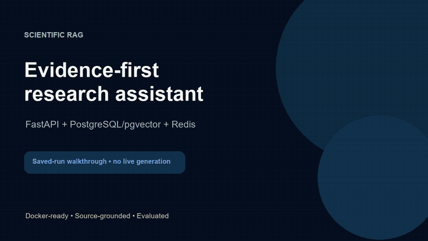
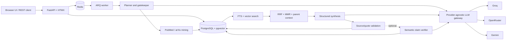

# Scientific RAG

Scientific RAG is an evidence-grounded research system for discovering scientific
literature, retrieving relevant passages, and producing source-aware reports. It
combines PubMed and arXiv mining, PostgreSQL full-text and pgvector retrieval,
structured synthesis, optional semantic claim verification, and cost-aware LLM
orchestration.

[Watch the 55-second demo](cost-aware-pipeline/docs/demo/scientific-rag-demo.mp4) ·
[Open the maintained application](cost-aware-pipeline/) ·
[Browse the documentation](docs/README.md)

[](cost-aware-pipeline/docs/demo/scientific-rag-demo.mp4)

> **Project status:** advanced research prototype. It is not a clinically
> validated medical system and must not be used as a substitute for professional
> judgment. Semantic verification is implemented, but live accuracy calibration
> is unfinished and the default mode remains `off`.

## Key capabilities

- PubMed and arXiv discovery with source-specific query construction and retries.
- PostgreSQL full-text search plus pgvector cosine similarity.
- Reciprocal-rank fusion (RRF), semantic MMR, and parent/child passage retrieval.
- Structured claims with source IDs and verbatim evidence quotations.
- Optional semantic claim verification in `off`, `shadow`, or `enforce` mode.
- Groq → OpenRouter → Gemini routing with bounded fallback and observability.
- Redis-backed ARQ jobs for research and evaluation work.
- Fast, Standard, and operator-enabled Deep research budgets.
- Per-run cost reservations, provider usage traces, and operational dashboards.
- Ragas evaluation, claim-level diagnostics, frozen-corpus comparisons, and
  regression datasets.

The production-oriented application is in
[`cost-aware-pipeline/`](cost-aware-pipeline/). Earlier Gradio and package-based
prototypes are retained under [`legacy/`](legacy/README.md) for provenance.

## Architecture



The API persists work before enqueueing it. The worker performs planning, mining,
retrieval, synthesis, and optional verification; Redis transports jobs, while
PostgreSQL remains the system of record.

## Quick start with Docker

Requirements:

- Docker Engine with the Compose plugin (Docker Desktop is suitable on Windows).
- A Gemini API key for embeddings.
- An Entrez email for PubMed.
- Optional Groq and OpenRouter keys for the complete fallback chain.

Research calls may incur provider charges. Saved results and the bundled demo do
not start model calls.

### Linux and macOS

```bash
git clone https://github.com/shay-dan/scientific-rag.git
cd scientific-rag/cost-aware-pipeline
cp .env.example .env
# Edit .env and replace every required placeholder.
docker compose up --build
```

### Windows PowerShell

```powershell
git clone https://github.com/shay-dan/scientific-rag.git
Set-Location .\scientific-rag\cost-aware-pipeline
Copy-Item .env.example .env
notepad .env
docker compose up --build
```

At minimum, configure `GOOGLE_API_KEY` (or `GEMINI_API_KEY`), `ENTREZ_EMAIL`,
`POSTGRES_PASSWORD`, `APP_API_KEYS`, and a 32-character
`APP_SESSION_SECRET`. Never commit `.env` or API keys.

When the services are healthy, open:

- Application: <http://localhost:8000>
- OpenAPI documentation: <http://localhost:8000/docs>
- Evaluation interface: <http://localhost:8000/evaluation>

Sign in with the key portion of an `APP_API_KEYS` entry such as
`admin:your-long-random-key`. Submit a question, choose Fast or Standard, and
follow the live stage updates. Deep is hidden unless an operator explicitly sets
`ENABLE_DEEP_RESEARCH=true`.

Stop the stack with `Ctrl+C`, or run `docker compose down` from another terminal.

## Development and verification

The supported runtime is Python 3.11. Docker is the most reproducible path:

```powershell
Set-Location .\cost-aware-pipeline
docker build --tag scientific-rag-local:latest .
docker run --rm `
  --volume "${PWD}\tests:/app/tests:ro" `
  scientific-rag-local:latest `
  python -m unittest discover -s tests -v
```

The PostgreSQL/pgvector and Redis integration checks are opt-in because they need
live services. See [CONTRIBUTING.md](CONTRIBUTING.md) for complete commands,
environment setup, and contribution expectations.

## Evaluation findings

Evaluation evidence in this repository is exploratory and intentionally preserves
negative results.

- A 12-question frozen-corpus pilot found **Hybrid Basic** (pgvector + PostgreSQL
  FTS + RRF) descriptively strongest, with overall quality **0.9250**. Naive RAG
  scored **0.9042**, Hybrid Enhanced **0.8958**, and Agentic Fast **0.8625**.
- In a retrieval-only ablation, dense retrieval achieved mean source recall
  **0.9514**. Adding MMR reduced it to **0.7847**; FTS/RRF recovered it to
  **0.9097**. Parent expansion made no difference on the short-passage snapshot.
- A later three-question structured-synthesis smoke test completed 3/3 with mean
  faithfulness **1.000**, answer relevancy **0.883**, context precision **0.833**,
  and context recall **0.700**.

These are small automated Silver evaluations, not a production benchmark or a
claim of general scientific accuracy. The frozen pilot disabled external mining,
which removes a central advantage of the agentic workflow. See
[RAG comparison conclusions](cost-aware-pipeline/evaluation/rag-comparison-conclusions.md)
and the [v14 quality-gate report](cost-aware-pipeline/evaluation/v14-structured-synthesis-quality-gate-report-2026-11-04.md).

## Repository map

```text
scientific-rag/
├── README.md                 # Project entry point
├── CONTRIBUTING.md           # Development and contribution guide
├── .github/workflows/        # Active CI and security checks
├── docs/                     # Documentation index and release notes
├── cost-aware-pipeline/      # Maintained FastAPI application
│   ├── app/                  # API, services, persistence, worker, UI
│   ├── src/scientific_rag/   # Research pipeline and LLM gateway
│   ├── tests/                # Unit, contract, and integration tests
│   ├── scripts/              # Evaluation and operational tools
│   ├── evaluation/           # Curated fixtures and experiment reports
│   ├── migrations/           # Alembic migrations
│   └── docs/                 # Detailed technical and validation notes
└── legacy/                   # Preserved historical prototypes
```

## Documentation

- [Documentation index](docs/README.md)
- [Application and operations manual](cost-aware-pipeline/README.md)
- [Semantic claim verification](cost-aware-pipeline/docs/semantic-claim-verifier.md)
- [Security and privacy review](cost-aware-pipeline/docs/security-privacy-review-2026-10-24.md)
- [Known limitations](docs/known-limitations.md)
- [Future release readiness](docs/release-readiness.md)
- [Historical implementations](legacy/README.md)

The repository does not currently declare a software license. Reuse terms remain
a maintainer decision until a license is selected.
