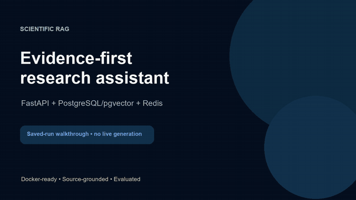

# Cost-Aware Scientific RAG

A Dockerized FastAPI, PostgreSQL full-text search, and pgvector research application with a resilient multi-provider LLM gateway and a browser UI.

[Watch the 55-second demo](docs/demo/scientific-rag-demo.mp4) · [Run locally with Docker](#run-with-docker) · [Recording notes](docs/demo/recording-guide.md)

[](docs/demo/scientific-rag-demo.mp4)

The demo is a captioned walkthrough of a saved evaluation, the claim-aware retrieval audit, and the original Ragas context-precision score. It does not trigger live model calls. The scores shown are evaluation metrics, not claims of clinical accuracy.

## What it provides

- `GET /` is the user-facing research interface.
- `POST /v1/research` runs the research pipeline and persists the completed report, source audit records, chunks, full-text index, and vector embeddings.
- `GET /v1/research/{run_id}` retrieves a prior run.
- `GET /healthz` checks API and database health.
- PostgreSQL tables for research runs, source documents, pgvector-ready chunks, and admin evaluation datasets/results.

Research requests use PostgreSQL full-text search and pgvector cosine search, fused with reciprocal-rank fusion, early semantic MMR, and parent/child passages. The legacy planner, gatekeeper, source mining, and synthesis steps are retained while the retrieval layer is replaced.

### LLM gateway

Research generation is provider-agnostic. Every planner, gatekeeper, orchestrator, expert, and synthetic-Q/A call uses one gateway with the default order:

1. Groq — `openai/gpt-oss-120b`
2. OpenRouter — `openrouter/free`
3. Gemini — the existing role-specific Flash policy

Unconfigured providers are skipped. Automatic fallback occurs only for transient/provider-availability failures: timeouts, connection failures, HTTP 408/409/429, HTTP 5xx, and an explicit model-unavailable 404. Configuration, authentication, invalid prompt/schema, and other 4xx errors stop immediately instead of being hidden by another provider.

Each research run persists safe observability metadata: provider, model, role, success/failure, status code, latency, reported token usage, fallback count, recovery-attempt latency, shared-throttle skips/wait, and Expert context character count. Prompts, responses, and API keys are not written to this trace. Embeddings and evaluation judges intentionally remain on Gemini so that the pgvector index and benchmark scores remain comparable.

The home screen has separate tabs for Research, Research history, Run details, Retrieval inspector, Evaluation dashboard, Queue, Audit log, Configuration, Provider diagnostics, Costs, and System health. Admin-only tabs are access-controlled. Retrieval traces record vector and PostgreSQL full-text candidate ranks, vector similarity, MMR order/effect, RRF score, parent/child lineage, final selection, and ranking exclusions. The lexical search uses PostgreSQL `websearch_to_tsquery` and `ts_rank_cd`; it is not BM25. Historical runs created before tracing show that the data was not collected. Evaluation comparisons and regression flags are observational, not statistical significance tests. The queue view supports ARQ cancellation and fresh retry of failed research. Feedback is stored separately for later dataset curation. Audit events omit prompts, answers, credentials, and free-text feedback. Configuration is read-only and never displays secrets. System health checks API, PostgreSQL/pgvector, Redis, and a worker heartbeat. Live provider checks are manual and make one short API request only when clicked.

Run details include the recorded pipeline timeline, provider calls, fallback attempts, source collection and selected evidence, and cache outcome. The history tab can filter by local date, status, and provider, open previous answers, and retry failed runs.

Configuration:

```ini
LLM_PROVIDER_ORDER=groq,openrouter,gemini
GROQ_API_KEY=...
GROQ_MODEL=openai/gpt-oss-120b
OPENROUTER_API_KEY=...
OPENROUTER_MODEL=openrouter/free
GOOGLE_API_KEY=...
LLM_REQUEST_TIMEOUT_SECONDS=90
LLM_GROQ_TIMEOUT_SECONDS=20
LLM_OPENROUTER_TIMEOUT_SECONDS=12
LLM_OPENROUTER_EXPERT_MAX_CONTEXT_CHARS=6000
LLM_GEMINI_TIMEOUT_SECONDS=45
LLM_GROQ_RPM_BUDGET=20
LLM_GROQ_TPM_BUDGET=6000
LLM_OPENROUTER_RPM_BUDGET=10
LLM_GROQ_GATEKEEPER_WAIT_SECONDS=4
```

Models may also be overridden per role, for example `GROQ_MODEL_EXPERT` or `OPENROUTER_MODEL_PLANNER`. Groq and OpenRouter expose OpenAI-compatible APIs; see their official [Groq compatibility](https://console.groq.com/docs/openai) and [OpenRouter free-router](https://openrouter.ai/openrouter/free) documentation.
The gateway uses Redis to share conservative one-minute request/token reservations between the API and worker. These defaults are **not** your provider account limits; inspect your own provider dashboards before raising them. Failed calls retain their estimated token reservation until the minute resets, while successful calls reconcile the estimate with reported token usage. A Groq Gatekeeper lease permits one such request at a time across processes; another request waits up to four seconds and then falls back. A 429 also creates a shared Redis cooldown. If Redis admission is unavailable, throttled providers fall back rather than sending an unmetered request; the unthrottled Gemini fallback remains available. This is an admission budget, not a guarantee that a provider will never return 429. The Provider diagnostics tab separates Expert-call latency and shows calls skipped before sending.
Each LLM attempt has a provider-specific deadline, so a slow free-model route cannot occupy the full research timeout. A provider that returns HTTP 429 enters a temporary cooldown; two retryable failures also open a temporary run-scoped circuit. `Retry-After`, when supplied, determines the 429 cooldown; otherwise `LLM_PROVIDER_COOLDOWN_SECONDS` defaults to 60. If Gemini then fails transiently, the gateway makes one short recovery pass through earlier providers whose cooldowns have expired, only while at least `LLM_RECOVERY_MIN_REMAINING_SECONDS` (default 10) remain. There are at most three actual provider attempts per LLM call, within `LLM_REQUEST_TIMEOUT_SECONDS` (default 90). The Gemini attempt timeout defaults to 45 seconds; override with `LLM_GEMINI_TIMEOUT_SECONDS`. OpenRouter remains in the normal order for short Expert contexts, but an Expert context over `LLM_OPENROUTER_EXPERT_MAX_CONTEXT_CHARS` (default 6000) bypasses it when another provider is available; this avoids repeated 12-second timeouts seen in local large-context probes. Set the limit to `0` to disable this size-based rule. The rule is a latency heuristic, not a claim that OpenRouter cannot answer larger prompts. PubMed's Entrez network calls now use an 8-second socket timeout, at most two Biopython attempts, and a thread-local 90-second fetch deadline. Configure `ENTREZ_REQUEST_TIMEOUT_SECONDS`, `PUBMED_FETCH_TIMEOUT_SECONDS`, `MINING_SOURCE_TIMEOUT_SECONDS` (150), and `RELEVANCE_SCREEN_TIMEOUT_SECONDS` (55) in `.env` if needed. A timed-out source is recorded in source diagnostics; other sources can still finish. The overall `REQUEST_TIMEOUT_SECONDS` remains 600 by default and failed runs retain the stage and a readable timeout message. Socket timeouts limit inactivity, not total response time under a slow trickle; an unusually slow synchronous request can still outlive a cancelled source task.

### Retrieval

The final answer searches only sources collected for the current run, preventing unrelated historical papers from leaking into an answer. Completed answers can be reused only for the same question, user, research mode, and pipeline version. Old runs remain visible in history after a pipeline update but are not served as current cached answers.

For a fresh API run, send `"fresh": true` in `POST /v1/research`, for example `{"question":"What are current uses of CRISPR in cancer research?","mode":"fast","fresh":true}`. The response reports `cached` and `retrieval_version`; check both when comparing runs. The browser result also has a **Run fresh research** button.

Before PubMed content is indexed, the LLM gateway screens each returned paper using its title and abstract (or an available full-text excerpt when the abstract is missing). Clearly irrelevant papers are rejected with a recorded reason; uncertain papers are retained to protect recall. If all configured judge providers fail, that paper is not indexed and the screening failure is shown in Retrieval inspector. This adds one structured gatekeeper call per returned PubMed paper; at most three screenings run concurrently. The decision and confidence are visible alongside each PubMed record in Retrieval inspector.

At answer time, retrieved abstracts, full-text sections, and arXiv preprints are labeled for the synthesis model. It is instructed to keep subgroup denominators separate, avoid attributing a cited prior paper's result to the selected paper, and distinguish retrospective/benchmark metrics from clinical outcomes. These are generation safeguards, **not** a guarantee that every answer is correct; numerical medical claims still need source-level review. A worked audit of two saved answers is in `docs/answer-audit-2026-10-21.md`.

For clinical CAR-T/B-cell-lymphoma questions, PubMed search keeps both intervention and disease terms, requests clinical-study publication types, and screens a wider candidate pool (at least 12, or 4× the paper budget) before indexing at most the configured per-source budget. Planner detail words such as “outcomes” are not mandatory search terms. The wider pool is abstract-first: rejected candidates are not downloaded as full-text PMC papers. Intervention, patient population, and evidence role are recorded in Retrieval inspector. CAR-NK and other treatments mentioned alongside CAR-T are not treated as CAR-T efficacy evidence. This can increase screening calls and latency; retrieved systematic reviews are secondary evidence and should not be described as primary clinical trials.

For breast-cancer machine-learning questions that specifically ask about mammography, PubMed search preserves three concept groups: machine/deep learning, breast cancer, and mammography/mammograms/tomosynthesis. A wider candidate pool (at least six, or 2× the paper budget) is screened before indexing at most the per-source budget. Title-and-abstract screening rejects clear modality substitutions such as Wisconsin FNA cytology, thermal imaging, or ultrasound-only work, while allowing studies that actually include mammography alongside another modality. Each rejection is visible with its reason in Retrieval inspector. This is a targeted, conservative rule, not a general medical relevance classifier.

PubMed study design is shown separately from relevance: a primary clinical study, systematic review/meta-analysis, narrative review, or unknown. The classification uses PubMed publication types first and a narrow title fallback. For clinical-evidence questions, a narrative review cannot be promoted to direct evidence by the LLM relevance screen; the limited shortlist favors primary studies over systematic reviews. Source cards show the classification and link to PubMed. This metadata is a screening aid, not an independent appraisal of study quality.

For CAR-T/B-cell-lymphoma clinical-evidence questions, the first PubMed search also requests clinical trials and systematic reviews by publication type. If that search returns nothing, the miner retries the broader anchored query. The inspector records the search term and any fallback. This does not guarantee that all returned trials test CAR-T—studies of other treatments can mention prior CAR-T, so the intervention/population screen still applies.

For PubMed full text, the miner accepts only the direct `pubmed_pmc` link, never `pubmed_pmc_refs` (papers cited by the PubMed article). It also checks that the fetched PMC XML contains the requested PMID. If no verified full text exists, the paper's PubMed abstract may still be screened and indexed; an unrelated PMC paper is never relabeled as that source.

## Cost controls

Every request has a fixed research budget. The limits reduce the number of papers, retrieved context documents, and generation calls. The Costs tab uses provider-reported token usage when available. It estimates USD only after you configure current input/output rates in `.env`; use model-specific variables such as `LLM_GROQ_OPENAI_GPT_OSS_120B_INPUT_USD_PER_MILLION` and the matching `_OUTPUT_...` rate. Provider-wide `LLM_GROQ_INPUT_USD_PER_MILLION` rates are also supported. Optional `COST_DAILY_BUDGET_USD` and `COST_MONTHLY_BUDGET_USD` settings enable budget alerts. Runs with missing token usage or rates remain unpriced, and the dashboard shows coverage so partial totals are visible.

| Mode | Plan steps | Papers per source | Context documents | Maximum generation calls |
| --- | ---: | ---: | ---: | ---: |
| Fast (default) | 1 | 2 | 5 | 5 |
| Standard | 2 | 3 | 8 | 8 |
| Deep (experimental) | 4 | 6 (up to 12 across both sources) | 14 | 15 |

- Exact repeated questions return the previously completed result without new model calls.
- Synthetic evaluation-dataset generation is disabled by default.
- Run records include the selected mode and limits in `model_metadata`; the API log records them too.

### Enable Deep research

Deep research is hidden from the user interface by default, because it can use a larger source and model-call budget. It expands planning, source collection, hybrid retrieval, and final evidence context; it still applies source screening, RRF, MMR, parent/child retrieval, and a finite context cap. More papers can add noise, so Deep should be compared with Standard rather than assumed to be better.

To make it a real selectable option, add the following to your private `.env` file and rebuild/restart the app:

```text
ENABLE_DEEP_RESEARCH=true
DEEP_RESEARCH_TIMEOUT_SECONDS=900
DEEP_RESEARCH_RUNS_PER_DAY=1
```

Do not commit `.env` to GitHub. The UI labels Deep as experimental, displays its expected 6–10 minute runtime and higher API usage, and asks for confirmation before starting. Non-admin users have a separate daily Deep quota; admins are exempt. An owner can cancel a queued or active run from its progress panel, while admins can also cancel it from the Queue dashboard.

## Evaluation with Ragas

Admins can create a small, human-reviewed Q/A dataset through `/evaluation`. Each evaluation can choose Fast, Standard, or (when enabled) Deep research depth. The worker runs the selected normal research path for each question, then evaluates the answer and retrieved context with Ragas: faithfulness, answer relevancy, context precision, and context recall. When a verified reference source excerpt is supplied, context precision and recall use an additional semantic Gemini judge rather than brittle exact-word matching.

Ragas uses the lower-cost `gemini-2.5-flash` judge by default (`RAGAS_JUDGE_MODEL`). For answer relevancy, it uses the same current native Gemini embedding configuration as the research pipeline, rather than an outdated LangChain embedding endpoint. If Ragas fails for one case, the worker records the error and uses the compact Gemini judge as a fallback rather than failing the entire evaluation.

To score an already completed run against an exact-question case in `evaluation/benchmark-v1.json` without paying for research again, run `docker compose run --rm --no-deps -v "${PWD}:/app" api python -m scripts.score_saved_run <run-id>` in PowerShell. This read-only helper reports genuine Ragas scores or an error; it does not substitute fallback judge scores or save a new dashboard result.

### Versioned benchmark

`evaluation/benchmark-v1.json` is a committed 10-case, human-reviewed regression benchmark spanning biomedical and technical questions. It is an input dataset, not a claim of overall model quality. Run it with the admin API key from `.env`:

```powershell
$env:APP_API_KEY = "<the admin key from APP_API_KEYS>"
.\scripts\run_benchmark.ps1 -Mode fast -CaseCount 1
```

The script assigns a timestamped dataset name so it is safe to run repeatedly, prints the API status URL, and leaves each result in PostgreSQL for comparison. It defaults to one case, so a full run requires `-CaseCount 10`. Use `fast` for a cheaper smoke test. `deep` is accepted only after `ENABLE_DEEP_RESEARCH=true` is set and Compose is rebuilt.

The script waits for the API health check for up to one minute after Compose starts. If it times out, inspect startup output with `docker compose logs api`.

Benchmark jobs have their own one-hour timeout (`EVALUATION_JOB_TIMEOUT_SECONDS=3600`), independent of the per-research-request timeout. The evaluation page reports research and judging progress for the current case.

## Run with Docker

Install and start Docker Desktop (or use a working Docker Engine with Compose). For a fresh checkout of the application branch:

```powershell
git clone --branch codex/production-rag-evaluation --single-branch https://github.com/shay-dan/scientific-rag.git
cd "scientific-rag/cost aware pipeline"
```

You need a Gemini API key for embeddings and evaluation. Groq and OpenRouter keys are optional but required to use their positions in the generation fallback chain. Research and evaluations may make billable provider calls; opening saved results does not start a new evaluation. This is a protected beta, not a public hosted service.

Copy `.env.example` to `.env`, set `GOOGLE_API_KEY` (or `GEMINI_API_KEY`), `ENTREZ_EMAIL`, `POSTGRES_PASSWORD`, `APP_API_KEYS`, and `APP_SESSION_SECRET`. Add `GROQ_API_KEY` and `OPENROUTER_API_KEY` to enable the full gateway, then run:

```powershell
Copy-Item .env.example .env
docker compose up --build
```

Copy the example only on first setup; do not overwrite an existing `.env`. Edit `.env` before starting Compose. Use the secret key portion after `admin:` in `APP_API_KEYS` to sign into the browser UI. Never commit `.env`.

Compose starts four services: the API, PostgreSQL/pgvector, Redis, and one durable research worker. The API stores a queued run in PostgreSQL and Redis delivers it to the worker, so an API restart does not cancel an already queued research request.

Open [http://localhost:8000](http://localhost:8000) for the user interface. The developer API documentation remains at [http://localhost:8000/docs](http://localhost:8000/docs).

## Run locally

Create a virtual environment, install `requirements.txt`, start PostgreSQL with pgvector, then run:

```powershell
python run_api.py
```

## Tests and logs

Run unit and API-contract checks:

```powershell
python -m unittest discover -s tests -v
```

During a real API run, request and research events are written to `logs/api.log` as well as the terminal. Follow them live with:

```powershell
Get-Content .\logs\api.log -Wait
```

The live PostgreSQL/pgvector tests are intentionally opt-in. They use temporary tables (no application rows are changed). With Docker running, execute the entire suite, including real vector-distance and PostgreSQL full-text queries:

```powershell
docker compose run --rm --no-deps -v "${PWD}\tests:/app/tests:ro" -e RUN_INTEGRATION_TESTS=1 api sh -lc 'DATABASE_URL_TEST="postgresql://scientific_rag:${POSTGRES_PASSWORD}@db:5432/scientific_rag" python -m unittest discover -s tests -v'
```

CI uses a temporary pgvector PostgreSQL service to run the same tests on pushes and pull requests. For a small real-world Fast/Standard comparison without Ragas, run `docker compose exec -T api python scripts/compare_research_modes.py`; it runs six fresh research requests sequentially and prints one JSON result per case. It uses your configured model APIs, so it may incur charges. The one-run-per-case results are diagnostic, not a statistically reliable latency or quality benchmark.

## Security note

The protected beta requires `APP_API_KEYS` and a 32-character `APP_SESSION_SECRET`. API clients provide `X-API-Key`; the browser UI has a key-based login. The built-in rate limit is in-memory, so replace it with Redis-backed limits before a multi-instance public deployment.
